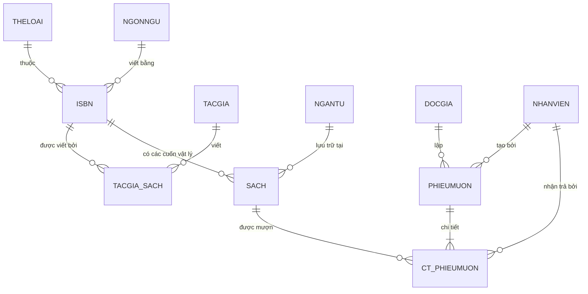

# 📱 TỔNG QUAN KIẾN TRÚC & CONTEXT DỰ ÁN QLTV (DÙNG CHO GEMINI MOBILE)

> **Mục đích:** File này tóm tắt toàn bộ "xương sống" dự án Quản Lý Thư Viện (QLTV). Khi bạn cần hỏi Gemini trên điện thoại, chỉ cần đính kèm file này hoặc dán nội dung vào để Gemini hiểu 100% ngữ cảnh mà không cần nén toàn bộ code.

---

## 1. THÔNG TIN CHUNG & CÔNG NGHỆ (TECH STACK)
* **Tên đồ án:** Hệ Thống Quản Lý Thư Viện (Đề 04 - Môn Hệ Quản Trị CSDL).
* **Kiến trúc:** 2-Tier Layered Architecture (`UI` $\rightarrow$ `DAO` $\rightarrow$ `Microsoft SQL Server`).
* **Ngôn ngữ & Thư viện:**
  * **Python 3.10+**: Core backend logic.
  * **CustomTkinter / Tkinter**: Giao diện Desktop hiện đại (Dark Mode).
  * **pyodbc**: Kết nối SQL Server (Tương thích ODBC Driver 18 & 17).
* **Hệ Quản Trị CSDL:** Microsoft SQL Server (SQLEXPRESS / Localhost).
* **Cơ chế xác thực:** SQL Server Authentication trực tiếp qua Login (`admin`, `nv_mai`, `nv_nam`, `docgia`). Không hardcode mật khẩu `sa`.

---

## 2. KIẾN TRÚC THƯ MỤC DỰ ÁN
```text
DB-Management-Project/
├── db.py                        # Quản lý kết nối pyodbc & lưu phiên đăng nhập (CURRENT_SESSION)
├── login.py                     # Màn hình đăng nhập qua SQL Server Authentication
├── QLTV_11_tables (1).sql       # DDL 11 bảng chuẩn + Filtered Indexes + View + Trigger
├── insert_sample_data.sql       # DML dữ liệu mẫu
├── setup_security_roles.sql     # Logins, Database Users, Roles (QUANLY, THUTHU, DOCGIA)
├── dao/                         # Tầng Data Access Object (Truy vấn CSDL)
│   ├── docgia_dao.py            # CRUD Độc giả, cấp lại thẻ, gia hạn, khóa thẻ
│   ├── sach_dao.py              # CRUD Đầu sách (ISBN), Sách vật lý (SACH), Vị trí (NGANTU)
│   ├── muontra_dao.py           # Nghiệp vụ mượn, trả, tính tiền phạt, kiểm tra điều kiện
│   └── thongke_dao.py           # Báo cáo KPI, sách quá hạn, top sách mượn nhiều
└── ui/                          # Tầng Giao diện (CustomTkinter)
    ├── ctk_patch.py             # Patch hỗ trợ placeholder cho CTkEntry
    ├── main_dashboard.py        # Dashboard chính, Sidebar điều hướng, xử lý RBAC
    └── tabs/
        ├── tab_docgia.py        # Giao diện quản lý độc giả
        ├── tab_sach.py          # Giao diện kho sách (Ẩn tính năng sửa/xóa với Thủ thư)
        ├── tab_muontra.py       # Giao diện lập phiếu mượn, trả sách & thu phạt
        └── tab_thongke.py       # Giao diện thống kê báo cáo số liệu thời gian thực
```

---

## 3. CƠ SỞ DỮ LIỆU: CẤU TRÚC 11 BẢNG & MỐI QUAN HỆ



### Chi tiết các bảng:
1. **THELOAI** (`MATL` [PK, CHAR 5], `THELOAI` [UQ, NVARCHAR 50])
2. **NGONNGU** (`MANGONNGU` [PK, INT IDENTITY], `NGONNGU` [UQ, NVARCHAR 50])
3. **NGANTU** (`MANGANTU` [PK, INT IDENTITY], `MOTA` [NVARCHAR 50], `KE` [NVARCHAR 100])
4. **TACGIA** (`MATACGIA` [PK, INT IDENTITY], `HOTENTG` [NVARCHAR 50], `DIACHITG`, `DIENTHOAITG`)
5. **DOCGIA** (`MADG` [PK, BIGINT IDENTITY], `HODG`, `TENDG`, `EMAILDG`, `SOCMND`, `GIOITINH`, `NGAYSINH`, `DIACHI`, `DIENTHOAI`, `NGAYLAMTHE`, `NGAYHETHAN`, `HOATDONG` [BIT])
6. **NHANVIEN** (`MANV` [PK, INT IDENTITY], `HONV`, `TENNV`, `GIOITINH`, `DIACHI`, `DIENTHOAI`, `EMAIL` [UQ])
7. **ISBN** (`ISBN` [PK, CHAR 10], `TENSACH`, `KHOSACH`, `NOIDUNG`, `SOTRANG`, `GIA`, `HINHANHPATH`, `NGAYXUATBAN`, `LANXUATBAN`, `NHAXB`, `MANGONNGU` [FK], `MATL` [FK])
8. **SACH** (`MASACH` [PK, VARCHAR 10], `ISBN` [FK], `TINHTRANG` [BIT: 1=Tốt, 0=Hỏng], `CHOMUON` [BIT: 1=Đang mượn, 0=Sẵn sàng], `MANGANTU` [FK])
9. **TACGIA_SACH** (`MATACGIA` [PK, FK], `ISBN` [PK, FK]) - Bảng trung gian quan hệ N-N.
10. **PHIEUMUON** (`MAPHIEU` [PK, BIGINT IDENTITY], `MADG` [FK], `HINHTHUC` [BIT: 1=Mang về, 0=Tại chỗ], `NGAYMUON`, `MANV` [FK])
11. **CT_PHIEUMUON** (`MAPHIEU` [PK, FK], `MASACH` [PK, FK], `NGAYTRA`, `TINHTRANGMUON` [BIT], `TRA` [BIT: 0=Chưa trả, 1=Đã trả], `MANVNS` [FK, Nhân viên nhận sách])

---

## 4. KỸ THUẬT CSDL ĐẶC BIỆT (ĐIỂM SÁNG ĐỒ ÁN)

### 4.1. Filtered Unique Index (Giải quyết bài toán mất thẻ / đổi thẻ)
* `UQ_DOCGIA_SOCMND_ACTIVE`: `CREATE UNIQUE INDEX ... ON DOCGIA(SOCMND) WHERE HOATDONG = 1 AND SOCMND IS NOT NULL;`
* `UQ_DOCGIA_EMAIL_ACTIVE`: `CREATE UNIQUE INDEX ... ON DOCGIA(EMAILDG) WHERE HOATDONG = 1 AND EMAILDG IS NOT NULL;`
* **Ý nghĩa:** Khi độc giả mất thẻ, thẻ cũ đổi thành `HOATDONG = 0`. Hệ thống cấp `MADG` mới với cùng số CMND/CCCD mà không bị lỗi trùng Unique Constraint.

### 4.2. Database Trigger: Đồng bộ trạng thái sách tự động
* `dbo.trg_DongBoTrangThaiSach` trên bảng `CT_PHIEUMUON` (`AFTER INSERT, UPDATE`):
  * Khi tạo lượt mượn (`TRA = 0`) $\rightarrow$ Tự động gán `SACH.CHOMUON = 1`.
  * Khi xác nhận trả sách (`TRA = 1`) $\rightarrow$ Tự động gán `SACH.CHOMUON = 0`.
* **Ý nghĩa:** Đảm bảo toàn vẹn dữ liệu ngay cả khi thủ thư hoặc DBA chạy lệnh INSERT/UPDATE trực tiếp bằng SQL trong SSMS.

### 4.3. View tính phạt thời gian thực (Chuẩn 3NF): `v_ChiTietPhieuMuon_Phat`
* Không thêm cột dư thừa vào bảng vật lý. View tự động tính:
  * `SoNgayDaMuon = DATEDIFF(DAY, NGAYMUON, ISNULL(NGAYTRA, GETDATE()))`
  * Nếu mượn mang về (`HINHTHUC = 1`) và quá 30 ngày $\rightarrow$ `SoNgayTre = SoNgayDaMuon - 30`.
  * Tiền phạt trễ: `TienPhatTre = SoNgayTre * 500 VNĐ`.
  * Hỗ trợ phạt hỏng (50% giá bìa `ISBN.GIA`) hoặc mất sách (100% giá bìa).

### 4.4. Cơ chế Phân quyền Role-Based Access Control (RBAC)
* 3 Roles:
  * `QUANLY`: Toàn quyền trên schema dbo (nhập sách, thêm bản sao, thanh lý, mượn trả, độc giả).
  * `THUTHU`: Quyền phục vụ bạn đọc (Cấp thẻ, mượn trả, xem sách, báo hỏng). Tuân thủ Least Privilege: **Không có quyền DELETE**.
  * `DOCGIA`: Chỉ có quyền `SELECT` tra cứu thông tin sách.
* Ánh xạ thông minh: Login `admin` $\rightarrow$ DB User `[3]` (MANV=3), Login `nv_nam` $\rightarrow$ DB User `[1]` (MANV=1).
* Nhận diện Role động qua Stored Procedure `sp_LayThongTinNhanVien(@LoginName)` bằng `SUSER_SID()`.

---

## 5. RÀNG BUỘC NGHIỆP VỤ MƯỢN / TRẢ SÁCH (LOGIC TRONG DAO)
1. **Kiểm tra thẻ:** Thẻ độc giả phải `HOATDONG = 1` và `NGAYHETHAN >= GETDATE()`.
2. **Giới hạn số lượng:** Mỗi độc giả không được giữ quá **3 cuốn sách** chưa trả.
3. **Kiểm tra tình trạng sách:** Sách phải sẵn sàng (`CHOMUON = 0`) và không hỏng (`TINHTRANG = 1`).
4. **Chống Race Condition:** Tạo phiếu mượn trong 1 Transaction nguyên tử (Atomic Lock).

---

## 6. DANH SÁCH TÀI KHOẢN THỬ NGHIỆM
| Tên Đăng Nhập | Mật Khẩu | Role Database | Mô tả |
| :--- | :--- | :--- | :--- |
| `admin` | `123456` | `QUANLY` | Trưởng thư viện / Quản lý toàn quyền |
| `nv_nam` | `123456` | `THUTHU` | Thủ thư phục vụ bạn đọc (MANV = 1) |
| `nv_mai` | `123456` | `THUTHU` | Thủ thư phục vụ bạn đọc (MANV = 2) |
| `docgia` | `123456` | `DOCGIA` | Tài khoản tra cứu công cộng |

---

## 7. MẪU PROMPT KHI HỎI GEMINI TRÊN ĐIỆN THOẠI

Khi hỏi Gemini trên điện thoại, bạn có thể copy các mẫu prompt dưới đây:

* **Mẫu 1: Hỏi cách viết câu truy vấn SQL / Báo cáo mới:**
  > *"Dựa vào schema 11 bảng của dự án QLTV trong file đính kèm, viết giúp tôi câu truy vấn SQL để [yêu cầu, vd: tìm top 5 độc giả mượn sách nhiều nhất trong tháng qua]. Hãy tối ưu index và giải thích logic."*

* **Mẫu 2: Hỏi cách viết thêm hàm trong DAO (Python):**
  > *"Dự án QLTV của tôi dùng Python pyodbc và 2-Tier Architecture. Hãy viết thêm hàm `[tên hàm]` trong `muontra_dao.py` để xử lý [nghiệp vụ], có bắt lỗi pyodbc và rollback transaction nếu xảy ra sự cố."*

* **Mẫu 3: Hỏi cách thiết kế thêm widget UI (CustomTkinter):**
  > *"Trong giao diện CustomTkinter của file `tab_sach.py`, tôi muốn thêm một nút bấm / bảng Treeview để [chức năng]. Viết code theo phong cách OOP kế thừa CTkFrame và đồng bộ màu Dark Mode của dự án."*
